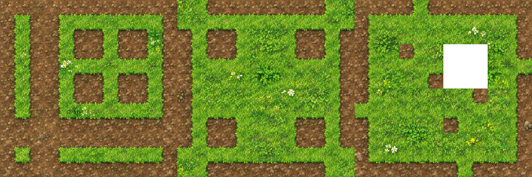
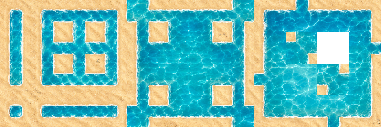

# Case 1：用 AI 制作 TileSet 47

这个例子把一张固定布局参考图生成成草地/泥土或海水/沙滩，再用「Tile47 标准图反推」整理为 Godot 可使用的 47 格图集。下载本目录后，可在自己的 AGAS 项目中按下面步骤组装；这里提供的是图片、提示词和工具源码，不是需要导入的场景包。

## 本目录有什么

| 文件 | 用途 |
| --- | --- |
| [reference/tilemap47-guide.png](reference/tilemap47-guide.png) | 原 tile47 参考底图，1024×512，16×8 格，每格 64 像素 |
| [prompts/grass-dirt.txt](prompts/grass-dirt.txt) | 草地/泥土的完整原始提示词 |
| [prompts/sea-sand.txt](prompts/sea-sand.txt) | 海水/沙滩的完整原始提示词 |
| [tools/tile47-standard-reverse.gd](tools/tile47-standard-reverse.gd) | 与产品预设一致的反推工具源码，可复制到自定义工具 |
| [samples/](samples/) | 已确认的生成原图和对应标准图，可先用来试工具与 Godot |
| [sources.json](sources.json) | 图片来源说明、尺寸和校验值 |

## 1. 准备项目和 AI 连接

- 打开 AGAS，选择自己的游戏开发项目。
- 把 `reference/tilemap47-guide.png` 复制到这个游戏项目内，例如 `case1/tilemap47-guide.png`，方便从 AGAS 的「文件」列表拖入画布。
- 在「设置 → AI 连接」配置自己的服务地址和 API Key，并选择可用的图片模型。本例不包含凭据。连接说明见 [AI Provider 配置](../../../config/ai-providers/README.md)。
- 本教程使用的模型为 `gemini-image`（视频中称 banana）或 **GPT Image 2.5 Flare**。模型列表和实际可用性取决于你的服务商及 Key 权限。

AI 输出可能随模型和请求而变化；示例展示工作方式，不保证每次得到完全相同的像素或完全无接缝。暂时没有 AI 连接，也可以从第 4 步开始，用附带的生成示例试反推工具。

## 2. 组装参考场景和提示词

1. 打开「场景」列表，点击 `+` 新增场景；通过场景右键菜单重命名为 `tile47`。
2. 保留一个放底图的图层，把「文件」中的 `case1/tilemap47-guide.png` 拖到画布。保持 **100% 尺寸、无旋转**，不要裁剪或重排这张底图。
3. 再建一个空图层，命名为 `生图结果`，选中它作为生成结果所在图层。底图图层保持可见。
4. 打开当前 `生图结果` 图层的提示词面板，点击「+ 片段」。选择下面一个文件，把**全部内容**粘贴进去并启用。也可以按文件中的五个段落分成五个片段，顺序不变；不要同时启用两套材质提示词或额外的旧提示词。

| 想生成的材质 | 完整提示词 | Material A：彩色占位区域 | Material B：背景和内部空洞 |
| --- | --- | --- | --- |
| 草地与泥土 | [grass-dirt.txt](prompts/grass-dirt.txt) | `grass.` | `dirt.` |
| 海水与沙滩 | [sea-sand.txt](prompts/sea-sand.txt) | `seawater.` | `sande.` |

这两份文件保留原始完整提示词，仅 Material A/B 不同。海水版的 `sande.` 是原片段拼写，随文件原样保留。关键要求包括保持参考图形状、拐角、内部空洞、格边归属和输出尺寸；不要只复制两行材质名称。

## 3. Q 框选，发送所有层

1. 将网格设为 **64**。底图应占 **16×8 格，即 1024×512 像素**。
2. 按 **Q**，沿底图外边框选完整区域，不能多出一圈或漏掉一部分。底图若放在 `(0, 0)`，对应框选从第 `0` 列、第 `0` 行开始，宽 `16` 格、高 `8` 格；放在别的位置时，框选也跟着移动。
3. 在顶部选择模型，确认当前图层是 `生图结果`。
4. 在框选区域右键，选择 **「所有图层发送」**（视频中口述为“发送所有层”），等待生成并在画布中检查结果。

若右键后提示正在获取模型、却没有开始任务，先等模型列表加载完成，再打开底部 AI 面板，确认模型和生成范围后点击 **「生成」**；无需反复右键发送。

“所有图层”会把可见内容送入参考图。本例只需要原布局底图：再次生成另一种材质前，移开或隐藏框选区域内的旧生成图片及其他无关图片，保留原参考底图可见；不要让上一次结果遮住底图。

## 4. 选择反推工具，按版本配置工具链

反推是本地图片处理，不调用 AI。**公开版已有「Tile47 标准图反推」预设，可以直接运行单个工具**：选中生成图片后，从画布右键的「工具箱」选择该预设；也可以在底部工具箱管理面板选中预设，点击「运行」。这种界面的工具链要求至少两步，本例不需要创建工具链，也不要为满足数量添加无关步骤。

如果你的版本只允许从右键菜单运行工具链，并且支持保存单步链，再按下面步骤配置：

1. 打开工具箱管理面板，在工具列表中找到 **「Tile47 标准图反推」**。
2. 点击 **「+ 工具链」**，名称可填 `Case1 Tile47 标准图反推`。
3. 在可选工具下拉框中选择 **「Tile47 标准图反推」**，点击 **「添加」**。执行顺序中只保留这一项，点击 **「保存」**。

| 配置项 | 本例值 |
| --- | --- |
| 工具预设 | `Tile47 标准图反推`（预设 ID：`tile47-standard-reverse`） |
| 执行方式 | 公开版直接运行预设；支持单步链的版本可保存一步工具链 |
| 输入 | 一张 1024×512 PNG，64 像素/格的原 16×8 布局 |
| 输出 | 一张 768×256 PNG，12×4 格，每格 64 像素 |
| 空槽 | 从 0 开始计数的第 10 列、第 1 行保持透明；另外 47 格用于瓦片 |

如果安装版本中没有这个工具预设：点击 **「+ 工具」**创建自定义工具，把 [tile47-standard-reverse.gd](tools/tile47-standard-reverse.gd) 的全部内容粘贴到代码编辑区并保存，再按你的版本直接运行或加入上述单步工具链。文件没有本机路径、网络请求或凭据，不需要修改脚本参数。它采用产品的 `process(image: Image)` 输入/输出约定。

## 5. 运行反推，找到输出

1. 回到画布，按 **E** 进入编辑/选择模式，选中刚生成的那张图片。
2. 在图片上右键，打开 **「工具箱」**子菜单。公开版选择 **「Tile47 标准图反推」**；只列出工具链的版本选择第 4 步保存的 **`Case1 Tile47 标准图反推`**。
3. 检查输出尺寸为 **768×256**，并检查透明空槽、拐角和窄通道形状。

如果使用带「运行」按钮的工具箱管理面板，先选中画布图片，再选预设并点击「运行」，结果相同。界面是否有该按钮取决于安装版本。

「文件」列表对应当前游戏项目内的图片。默认输出位置是：

```text
游戏项目/
└── agas/
    ├── tile47/
    │   └── 生图结果/
    │       └── Result N.png    ← AI 生成原图
    └── tools/
        └── tile47-standard-reverse-<随机标识>.png  ← 公开版工具处理结果
```

场景名、图层名会影响 AI 输出目录；`Result N.png` 的编号由项目已有文件决定。工具输出统一放在项目级 `agas/tools/`，公开版使用“工具 ID + 随机标识”，有些版本使用 `Tools N.png`。以运行后画布新增图片、实际输出路径或文件修改时间定位，并核对内容；不要依赖工具文件的最大数字。下文 `Tools 11/12` 只是本教程制作时的示例原文件名，不是读者运行后必须出现的名称。

若工具提示输入尺寸错误，先检查实际 PNG 是否为 1024×512，以及 Q 框选是否正好覆盖原图。此反推脚本按固定布局复制像素，不会修复 AI 已经画错的形状。输入应为 **RGBA PNG**；若某个服务返回 RGB 文件，先用图像编辑器无损另存为 RGBA PNG 再运行，避免像素格式不一致导致空白输出。

## 6. 用附带示例对照，再进入 Godot

| 材质 | AI 生成原图，1024×512 | 反推标准图，768×256 |
| --- | --- | --- |
| 草地/泥土 | [grass-generated.png](samples/grass-generated.png) | [grass-atlas.png](samples/grass-atlas.png) |
| 海水/沙滩 | [sea-sand-generated.png](samples/sea-sand-generated.png) | [sea-sand-atlas.png](samples/sea-sand-atlas.png) |





示例来自本次已确认的草地 `Result 23 → Tools 12`、海水沙滩 `Result 22 → Tools 11`，这里只用清楚的文件名保存副本。想先验证工具，可以把 `*-generated.png` 复制到游戏项目，从「文件」拖入画布，再按第 5 步运行。

在 Godot 4.3+ 中创建 **TileMapLayer**，为它设置 TileSet，并把 **反推后的标准图**添加为图集源。将 TileSet 的 Tile Size 和图集的 Texture Region Size 都设为 **64×64**，然后为有效瓦片配置 Terrain Set、地形与对应的边角连接位，再使用地形绘制。优先检查单格宽通道、连续转角、T 形和十字交汇处。

PNG 图集本身不包含 Godot 的 terrain 连接配置。本目录提供的是图片生成与标准图整理流程；可以自行配置 terrain，也可使用自己的地形配置/绘制工具。不要把 1024×512 的生成原图直接当作这里的 12×4 标准图集。

## 素材来源

参考图、原始提示词和示例输出由项目维护者提供；工具源码取自本仓库内置预设，尺寸及校验值见 [sources.json](sources.json)。代码许可和 AI 服务/生成内容的使用条件不是同一件事，详见根目录 [素材与服务说明](../../../THIRD_PARTY_LICENSES.md#素材与服务)。本目录不包含 API Key、用户设置或整个游戏项目。
